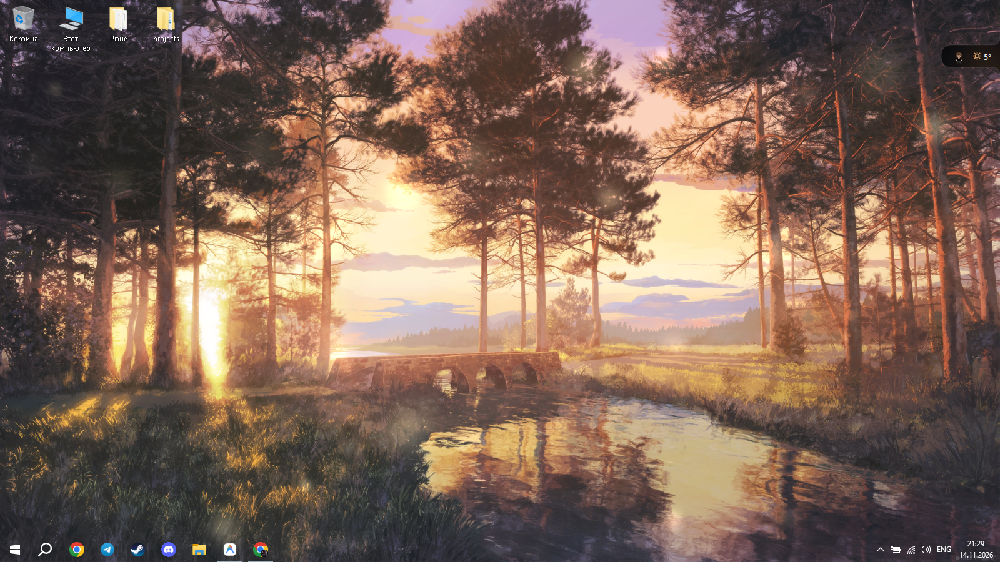
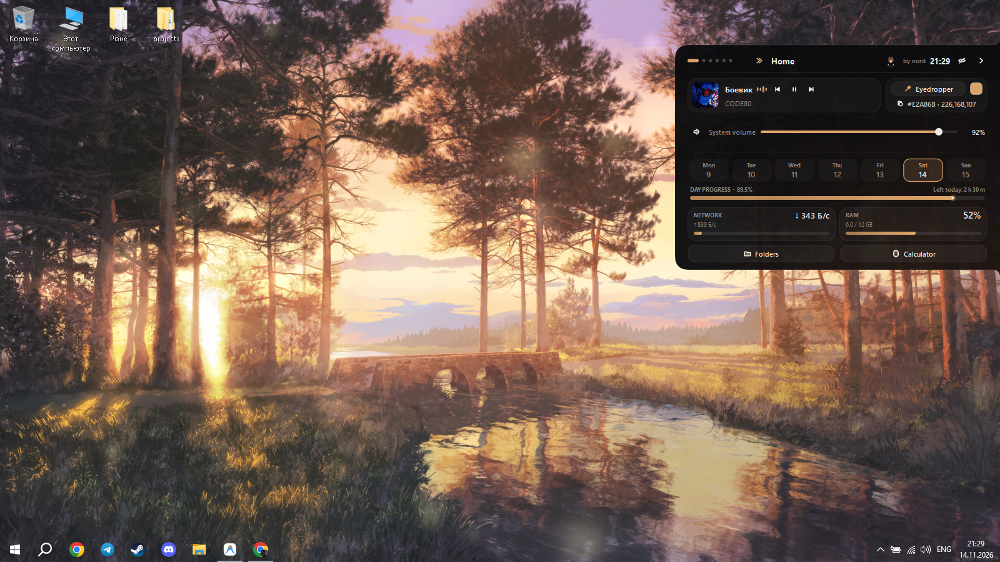
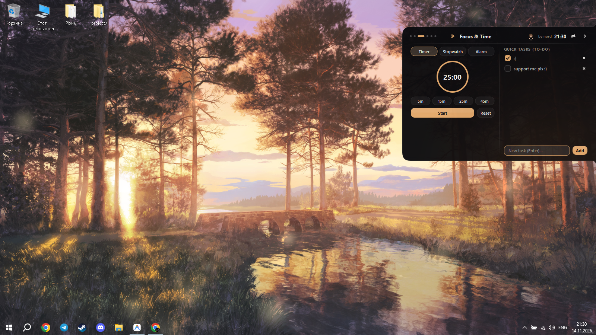
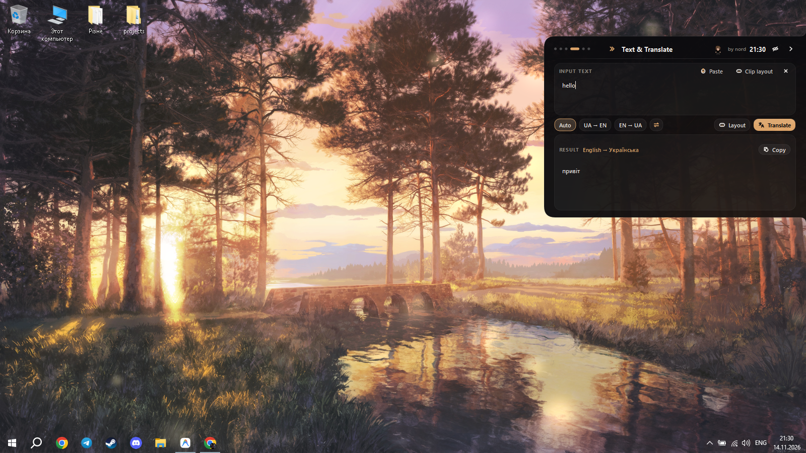
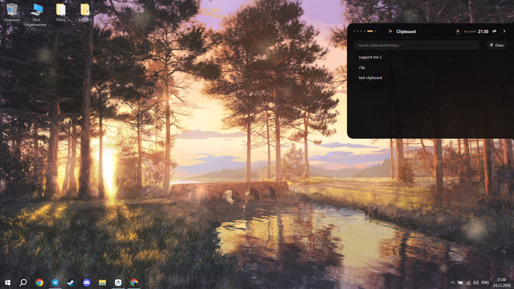
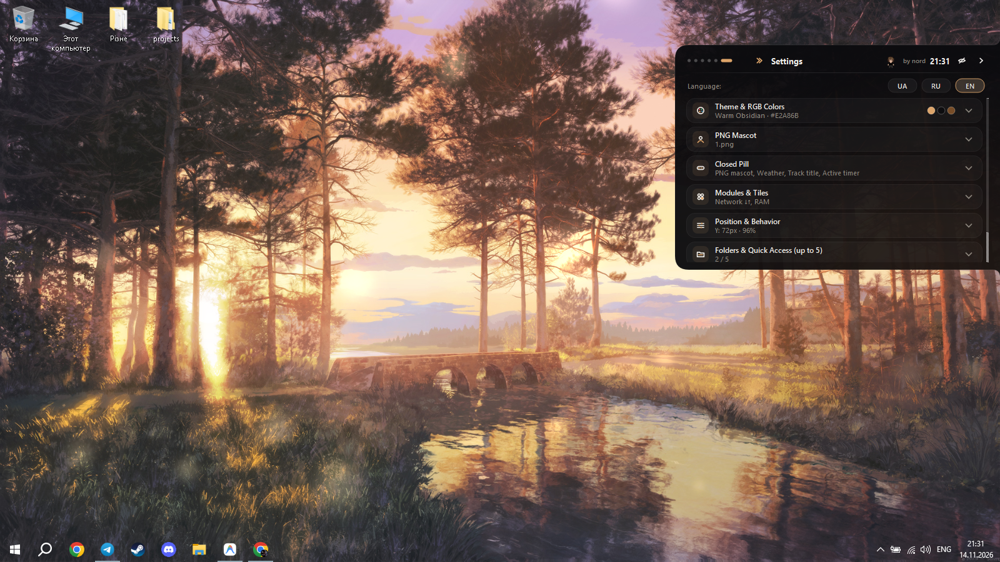

<div align="center">

# 💊 WinCapsule `by nord`

**Smart Floating Capsule Utility for Windows 10 / 11**

**English** | [Русский](README.ru.md)

[-E2A86B.svg)](LICENSE)


A sleek, borderless floating desktop capsule built with PySide6 that stays cleanly tucked at the top of your screen and expands into a rich productivity, system, weather, media, and translation hub.

</div>

---

## ✨ Screenshots

<details open>
<summary><b>📸 View Screenshots Gallery (7 previews)</b></summary>

| Collapsed Capsule | Home Dashboard |
| :---: | :---: |
|  |  |

| Weather Telemetry | Focus & Time + To-Do |
| :---: | :---: |
|  |  |

| Text & Translate | Clipboard Manager |
| :---: | :---: |
|  |  |

| Settings & RGB Customization |
| :---: |
|  |

</details>

<details>
<summary><b>🎬 Video Overview (MP4 placeholder — coming soon)</b></summary>

> The video walkthrough has not been recorded yet. This section is wired to [`assets/video/demo.mp4`](assets/video/demo.mp4) and will play inline on GitHub as soon as the final `.mp4` recording is uploaded.

https://github.com/nordnord1/WinCapsule/raw/main/assets/video/demo.mp4

[`assets/video/demo.mp4`](assets/video/demo.mp4)

</details>

---

## 🚀 Key Features

- **Compact Floating Capsule**: Smooth hover/click animations, vertical offset and opacity controls, optional **PNG mascot** avatar, live weather badge, active track ticker, or active timer readout.
- **Home Dashboard**:
  - **Live Media Controls (Windows SMTC)**: Play/pause, skip tracks, album art thumbnail, and animated waveform.
  - **Screen Eyedropper**: Pick any pixel color from your screen with HEX + RGB copy.
  - **System Volume Slider**: Instant Windows master volume control & mute toggle.
  - **Week Strip & Day Progress Bar**: Visual daily timeline tracking time remaining today.
  - **Configurable 3-Slot Telemetry Tiles**: Choose any combination of `CPU`, `RAM`, `Disk C:`, `Disk D:`, `Network ↓↑`, `Weather`, or `Focus / Tasks`.
  - **Quick Folders & Calculator**: Slide-out menu for up to 5 favorite folders + instant Windows Calculator launch.
- **Weather Tab (OpenWeather)**: Temperature, feels-like, min/max, circular animated wind compass, humidity comfort bar, pressure arc gauge (mmHg), precipitation, and visibility/cloud cover.
- **Focus & Time**: Pomodoro / custom countdown **Timer**, **Stopwatch**, **Alarms** with custom notes, and a quick **To-Do** checklist synced with the Home tiles.
- **Text & Translate**:
  - **Quick Screen OCR & Translate**: Snip any screen region and click **Copy** or **Translate** right on the selection to capture text via Windows OCR, Tesseract, or cloud OCR fallback.
  - **6-Language Expanding Dropdown Translator**: Translate between **Auto**, **Ukrainian**, **English**, **Russian**, **Spanish**, **French**, and **Polish** with instant I/O & language swapping.
  - **Wrong Keyboard Layout Fixer**: Fixes mistyped text (`ghbdsn` ↔ `привіт`) directly from the input box or clipboard in one click.
- **Clipboard History**: Automatic clipboard capture with instant search, click-to-copy, **single-item delete**, and configurable history limit.
- **Settings & Personalization**:
  - **5 Built-in Presets** (`Warm Obsidian`, `Obsidian`, `Midnight`, `Emerald`, `Crimson`) + full **RGB / HEX color sliders** for Accent, Background, and Ambient Glow.
  - **Device & Download Toasts**: Live pop-up alerts when USB drives, mice, or Bluetooth headphones connect, plus folder download completion/pause toasts with quick *Open* / *Folder* actions.
  - **Autostart (`shell:startup`)**: One-click Windows Startup toggle directly in Settings.
  - **Full Live Localization**: Instant switching between **UA**, **RU**, and **EN**.

---

## 💖 Support Me

If you find **WinCapsule** useful and want to support further updates and improvements, you can donate via crypto:

- **BTC:** `bc1qcl7rmmc08pum6gljc45rq4004k5azktqp9lsge`
- **Ethereum:** `0x2168A8e00f503D61cDe7C878321531c17C9D6089`
- **Tron (TRC-20):** `TQj86sAZqMg8NeYksT1ZCzKV4TCjtU2PUA`
- **TON:** `UQAZ2pLXFMrCS2DShL4i94VCXv76pRHgUU83cW56sv_CE9Ui`

---

## 🌤️ How to Get a Free OpenWeather API Key

Weather updates require your own free **OpenWeather** API key (stored locally on your PC in `config.json`):

1. Go to [openweathermap.org](https://openweathermap.org/) and click **Sign In** → **Create an Account** (free tier is all you need).
2. Complete registration and **confirm your email address** via the verification email from OpenWeather (API keys stay inactive until email verification is complete).
3. Click your username in the top-right corner and select **My API keys** (direct link after login: [home.openweathermap.org/api_keys](https://home.openweathermap.org/api_keys)).
4. OpenWeather creates a `Default` key automatically, or you can enter a name (e.g., `WinCapsule`) and click **Generate**.
5. Copy the 32-character API key.
   > **Note:** New OpenWeather API keys usually take **15 minutes to 2 hours** after registration to activate. If you initially see an invalid key message, wait a little while and try again.
6. In **WinCapsule**, open **Settings (tab 6) → Weather**:
   - Paste your key into **API Key**
   - Enter your city (e.g., `London` or `Kyiv,UA`)
   - Click **Apply** — live weather will load automatically!

---

## 🛠️ Installation & Running

### Option 1: Download Standalone Executable (`WinCapsule.exe`)
Download **`WinCapsule.exe`** from the [**GitHub Releases**](../../releases) page and launch it directly — no Python installation required.

### Option 2: Run from Source
```powershell
git clone https://github.com/nordnord1/WinCapsule.git
cd WinCapsule

python -m venv .venv
.\.venv\Scripts\Activate.ps1
pip install -r requirements.txt

python main.py
```

### Build `WinCapsule.exe` Yourself (PyInstaller)
```powershell
pip install pyinstaller
pyinstaller --onefile --windowed --name WinCapsule --icon=icon.ico --add-data "icon.ico;." main.py
```
The compiled executable will appear in `dist\WinCapsule.exe`.

### Run Tests
```powershell
python -m pytest -v
```

---

## 📜 License & Attribution

Licensed under the **WinCapsule Non-Commercial Source-Available License** — see [`LICENSE`](LICENSE) for full details.

- ✅ **Allowed**: Using, forking, modifying, and sharing for **personal, educational, and non-commercial** purposes.
- ❌ **Prohibited**: Any **commercial use**, paid distribution, or monetization without written permission from **nord**.
- 🏷️ **Required**: Retain [`LICENSE`](LICENSE) and preserve the original **`by nord`** attribution in all forks and derivative works.
