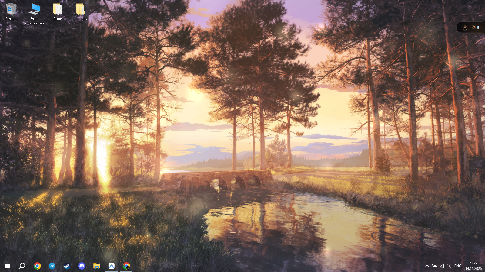
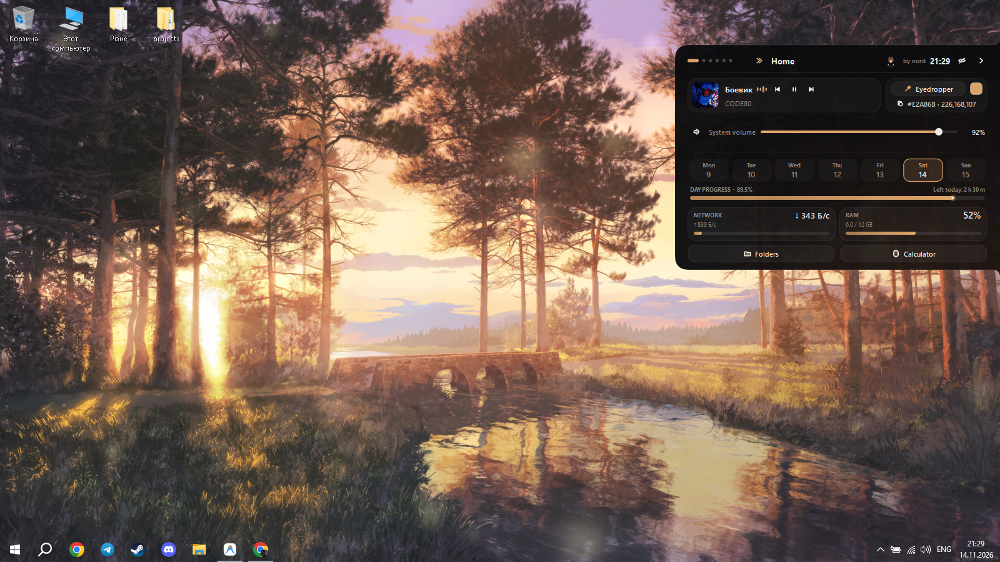
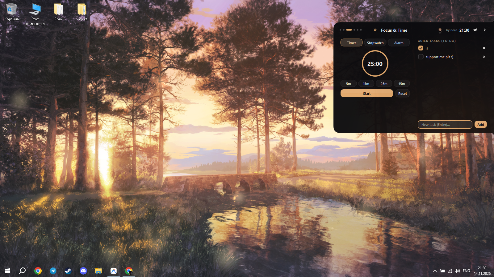
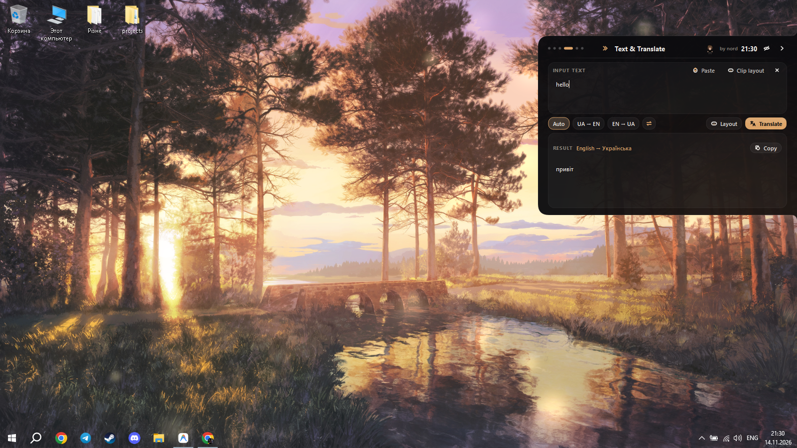
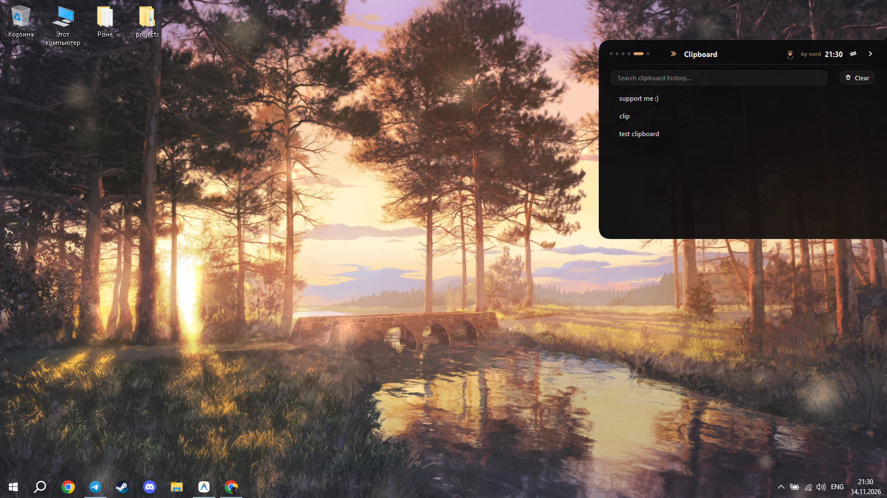
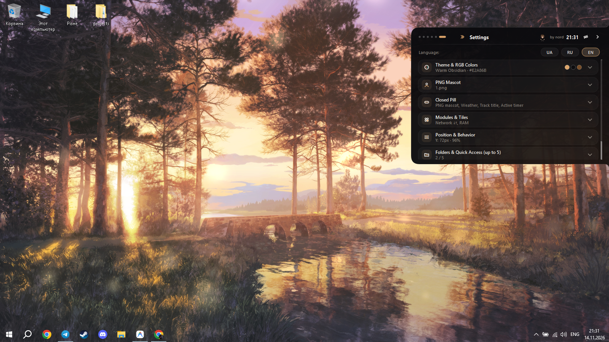

<div align="center">

# 💊 WinCapsule `by nord`

**Умная плавающая капсула-помощник для Windows 10 / 11**

[English](README.md) | **Русский**

[-E2A86B.svg)](LICENSE)


Стильная безрамочная плавающая капсула на PySide6, которая аккуратно закрепляется у верхней границы экрана и по клику разворачивается в панель управления музыкой, погодой, фокусом, переводом текста, буфером обмена и телеметрией ПК.

</div>

---

## ✨ Скриншоты

<details open>
<summary><b>📸 Открыть галерею скриншотов (7 превью)</b></summary>

| Свёрнутая капсула | Главная панель |
| :---: | :---: |
|  |  |

| Подробная погода | Фокус и Время + Задачи |
| :---: | :---: |
|  |  |

| Текст и Перевод | Буфер обмена |
| :---: | :---: |
|  |  |

| Настройки и RGB-кастомизация |
| :---: |
|  |

</details>

<details>
<summary><b>🎬 Видеообзор (MP4-заглушка — скоро будет добавлен)</b></summary>

> Видеообзор ещё не записан. Эта вкладка уже привязана к файлу [`assets/video/demo.mp4`](assets/video/demo.mp4) и начнёт воспроизводиться прямо на GitHub сразу после загрузки финального `.mp4` ролика.

https://github.com/nordnord1/WinCapsule/raw/main/assets/video/demo.mp4

[`assets/video/demo.mp4`](assets/video/demo.mp4)

</details>

---

## 🚀 Основные возможности

- **Компактная плавающая капсула**: плавные анимации наведения и раскрытия, настройка вертикального отступа и прозрачности, свой **PNG-персонаж** (маскот), мини-погода, бегущая строка трека или активный таймер.
- **Главная панель**:
  - **Управление плеером (Windows SMTC)**: переключение треков, пауза/плей, обложка альбома и анимированная волна.
  - **Пипетка экрана**: захват цвета с любой точки монитора с копированием HEX и RGB.
  - **Системная громкость**: плавный ползунок и кнопка быстрого отключения звука.
  - **Шкала недели и прогресс дня**: наглядный прогресс текущих суток.
  - **3 настраиваемые плитки телеметрии**: любые комбинации `CPU`, `RAM`, `Диск C:`, `Диск D:`, `Сеть ↓↑`, `Погода`, `Фокус / Задачи`.
  - **Быстрые папки и Калькулятор**: выезжающее меню для 5 избранных папок + запуск Калькулятора Windows.
- **Погода (OpenWeather)**: температура, ощущается как, мин/макс, круглый компас ветра, шкала комфорта влажности, дуговой индикатор давления (мм рт. ст.), осадки, видимость и облачность.
- **Фокус и Время**: **Таймер** с пресетами, **Секундомер**, **Будильники** с заметками и список быстрых задач (**To-Do**).
- **Текст и Перевод**:
  - **Выпадающее меню переводчика на 6 языков**: перевод между **Авто**, **Украинским**, **Английским**, **Русским**, **Испанским**, **Французским** и **Польским** + быстрая смена направления `⇄`.
  - **Исправление раскладки клавиатуры**: мгновенно чинит текст вида `ghbdsn` ↔ `привіт` из поля ввода или прямо из буфера обмена.
- **Буфер обмена**: история скопированных фрагментов с мгновенным поиском, копированием по клику и **точечным удалением отдельной записи**.
- **Настройки и персонализация**:
  - **5 готовых тем** (`Warm Obsidian`, `Obsidian`, `Midnight`, `Emerald`, `Crimson`) + **RGB / HEX слайдеры** для акцента, фона и свечения.
  - **Уведомления устройств и загрузок**: всплывающие тосты при подключении мыши, флешки или Bluetooth-наушников, а также отслеживание скачиваний с кнопками *Открыть* / *Папка*.
  - **Автозапуск (`shell:startup`)**: включение запуска вместе с Windows в один клик.
  - **Полная локализация интерфейса**: переключение на лету между **UA**, **RU** и **EN**.

---

## 💖 Support Me / Поддержать автора

Если **WinCapsule** оказался вам полезен и вы хотите поддержать дальнейшее развитие проекта:

- **BTC:** `bc1qcl7rmmc08pum6gljc45rq4004k5azktqp9lsge`
- **Ethereum:** `0x2168A8e00f503D61cDe7C878321531c17C9D6089`
- **Tron (TRC-20):** `TQj86sAZqMg8NeYksT1ZCzKV4TCjtU2PUA`
- **TON:** `UQAZ2pLXFMrCS2DShL4i94VCXv76pRHgUU83cW56sv_CE9Ui`

---

## 🌤️ Как получить бесплатный API-ключ OpenWeather

Для отображения погоды нужен собственный бесплатный ключ **OpenWeather** (он хранится только локально у вас на ПК в `config.json`):

1. Перейдите на [openweathermap.org](https://openweathermap.org/) и нажмите **Sign In** → **Create an Account** (бесплатного тарифа полностью достаточно).
2. Завершите регистрацию и **обязательно подтвердите email** по ссылке из письма от OpenWeather (пока почта не подтверждена, ключ не активируется).
3. Нажмите на свой профиль в правом верхнем углу и выберите **My API keys** (или откройте [home.openweathermap.org/api_keys](https://home.openweathermap.org/api_keys)).
4. Вы можете использовать ключ `Default`, созданный автоматически, или задать имя (например, `WinCapsule`) и нажать **Generate**.
5. Скопируйте 32-символьный API-ключ.
   > **Важно:** новый API-ключ OpenWeather обычно активируется в течение **15 минут – 2 часов** после регистрации. Если сразу появляется ошибка неверного ключа — просто подождите немного и нажмите обновление.
6. В **WinCapsule** откройте **Настройки (вкладка 6) → Погода**:
   - Вставьте ключ в поле **API-ключ**
   - Укажите свой город (например, `London` или `Kyiv,UA`)
   - Нажмите **Применить** — погода подгрузится автоматически!

---

## 🛠️ Установка и запуск

### Вариант 1: Готовый `.exe` (`WinCapsule.exe`)
Скачайте **`WinCapsule.exe`** со страницы [**GitHub Releases**](../../releases) и запустите — установка Python не требуется.

### Вариант 2: Запуск из исходников
```powershell
git clone https://github.com/nordnord1/WinCapsule.git
cd WinCapsule

python -m venv .venv
.\.venv\Scripts\Activate.ps1
pip install -r requirements.txt

python main.py
```

### Самостоятельная сборка `WinCapsule.exe` (PyInstaller)
```powershell
pip install pyinstaller
pyinstaller --onefile --windowed --name WinCapsule --icon=icon.ico --add-data "icon.ico;." main.py
```
Готовый файл появится в `dist\WinCapsule.exe`.

### Запуск тестов
```powershell
python -m pytest -v
```

---

## 📜 Лицензия и авторство

Проект распространяется по лицензии **WinCapsule Non-Commercial Source-Available License** — подробнее в файле [`LICENSE`](LICENSE).

- ✅ **Разрешено**: использовать, делать форки, изменять и распространять в **личных, учебных и некоммерческих** целях.
- ❌ **Запрещено**: любое **коммерческое использование**, продажа или монетизация без письменного разрешения автора (**nord**).
- 🏷️ **Обязательно**: сохранять файл [`LICENSE`](LICENSE) и оригинальный подпись **`by nord`** во всех форках и производных проектах.
